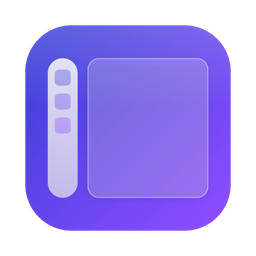
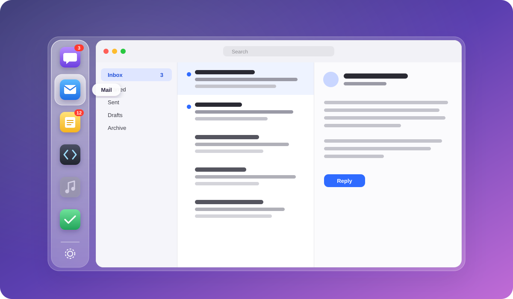
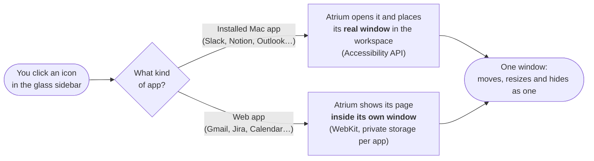

<p align="center">
  
</p>

<h1 align="center">Atrium</h1>

<p align="center">
  <b>One Liquid Glass window for every app you use: your real Mac apps snap in beside the sidebar, and your web apps run right inside it, with no browser wrappers.</b>
</p>

<p align="center">
  
  
  
  
  <a href="LICENSE"></a>
  <a href="https://github.com/Alif-B/atrium/stargazers"></a>
</p>

<p align="center">
  <a href="#-why-atrium">Why Atrium</a> ·
  <a href="#-features">Features</a> ·
  <a href="#-how-it-works">How it works</a> ·
  <a href="#-install">Install</a> ·
  <a href="#-faq">FAQ</a>
</p>

<p align="center">
  
</p>

> [!NOTE]
> **Atrium is a Mac app, and Mac only.** It is built for macOS 26 Tahoe with Apple's own frameworks, and does not run on Windows or Linux.

---

## ✨ Why Atrium

Your day lives in a dozen apps: chat, mail, calendar, tickets, notes, music. They scatter across the screen, hide behind each other, and turn ⌘-Tab into a guessing game. Hub apps like Rambox fix that by wrapping *websites*, so you trade your real Mac apps for slower web copies.

**Atrium keeps the real thing.** Your installed apps stay native, with all their speed, menus and shortcuts, and simply live inside one calm window. Sites that only exist on the web run inside Atrium too.

|  | **Atrium** | Web-app hubs (Rambox and similar) | Separate windows |
|---|:---:|:---:|:---:|
| Your real native Mac apps | ✅ | ❌ web versions only | ✅ |
| Web apps in the same window | ✅ | ✅ | ❌ |
| Everything moves and resizes as one | ✅ | ✅ | ❌ |
| Unread badges for every app in one place | ✅ | ✅ | ❌ |
| Built with Apple's own frameworks | ✅ Swift + Liquid Glass | ❌ Electron | n/a |
| Free and open source | ✅ GPL-3.0 | varies | n/a |

---

## 🧩 Features

<table>
<tr>
<td width="50%" valign="top">

### 🪟 Real apps, one window
Click an icon and that app's real window snaps in beside the sidebar. Move, resize, minimize or hide Atrium, and every app comes along, as if they were one app.

</td>
<td width="50%" valign="top">

### 🌐 Web apps, built in
Add any website as an app. It runs inside Atrium with **its own private sign-in**, separate from your browsers and from each other. Notifications, downloads and sign-in pop-ups all work.

</td>
</tr>
<tr>
<td valign="top">

### 💎 Liquid Glass, done properly
A true macOS 26 glass rail, a lens that glides to the app you pick, gentle hover magnification, and a soft crossfade when you switch.

</td>
<td valign="top">

### 🔴 Badges that mean something
Unread counts from every app, native or web, gathered on one rail. An optional sound plays only when something *new* arrives, never for the app you're looking at.

</td>
</tr>
<tr>
<td valign="top">

### 😴 Hibernation
Let rarely used apps fall asleep after 15 minutes to save memory. Atrium never puts an app to sleep while it plays music or is on a call.

</td>
<td valign="top">

### 🧘 Calm by design
Apps load quietly behind a "getting ready" card at launch, closed apps turn grey, friendly cards replace empty space, and everything puts itself back after sleep or a display change.

</td>
</tr>
<tr>
<td valign="top">

### 🎨 Make it yours
Drag icons to reorder them. Pick or paste a custom icon and size it. Right-click any app to reload, relaunch, edit, hibernate or remove it.

</td>
<td valign="top">

### 🔒 Private by default
No accounts, no tracking, no analytics. Your app list stays in `~/Library/Application Support/Atrium`. Nothing leaves your Mac except what your web apps load themselves.

</td>
</tr>
</table>

---

## ⚙️ How it works

macOS has no way to put another app's window *inside* your own. So Atrium does the next best thing: it places each app's real window exactly over its workspace, keeps itself directly underneath, and moves the two together. Web apps take a simpler path: they are pages drawn inside Atrium itself.



When you drag or resize Atrium, the apps are briefly swapped for a still image, so the window glides without flicker, then they reappear in their new place.

---

## 🚀 Install

### Requirements

| | |
|---|---|
| 💻 **Mac** | macOS 26 Tahoe or later (Apple Silicon recommended) |
| 🛠 **Tools** | Swift from the Command Line Tools (`xcode-select --install`). Xcode is **not** needed. |
| 🔑 **Accessibility** | Required, so Atrium can place app windows. macOS asks the first time. |
| 🎥 **Screen Recording** | Optional, for the seamless still image while moving and switching. |

### Build and launch

```bash
git clone https://github.com/Alif-B/atrium.git
cd atrium
./scripts/build.sh
open ~/Applications/Atrium.app
```

`build.sh` compiles Atrium, signs it and installs it to `~/Applications`. Then click **+** in the sidebar to add your apps.

<details>
<summary><b>Keep the Accessibility permission across rebuilds (recommended)</b></summary>

<br>

macOS forgets the Accessibility permission whenever an unsigned app changes. Creating a free self-signed certificate once fixes that. It takes about a minute; see [`scripts/SIGNING.md`](scripts/SIGNING.md).

</details>

<details>
<summary><b>Developer commands</b></summary>

<br>

| Command | What it does |
|---|---|
| `./scripts/run.sh` | Build and relaunch (`--demo` shows sample data and touches nothing) |
| `./scripts/test.sh` | Run the test suite (Swift Testing) |
| `log stream --predicate 'subsystem == "com.alif.atrium"' --level debug` | Watch Atrium's logs |

Always use the scripts rather than a bare `swift build`: `scripts/env.sh` works around a stale `PackageDescription` interface found in some Command Line Tools installs.

</details>

---

## ⌨️ Handy shortcuts

| Shortcut | Action |
|---|---|
| Click an icon | Show that app in Atrium |
| Right-click an icon | Reload / Relaunch, Edit, Hibernate, Close / Quit, Remove |
| Drag an icon | Reorder the sidebar |
| Double-click empty sidebar space | Fill the screen, and back |
| <kbd>⌘</kbd> <kbd>R</kbd> | Reload the web app on show |
| <kbd>⌘</kbd> <kbd>[</kbd> / <kbd>⌘</kbd> <kbd>]</kbd> | Back / Forward in a web app |
| <kbd>⌘</kbd> <kbd>+</kbd> / <kbd>⌘</kbd> <kbd>−</kbd> / <kbd>⌘</kbd> <kbd>0</kbd> | Zoom a web app in, out, or back to actual size |
| <kbd>⌘</kbd> <kbd>,</kbd> | Settings |

---

## ❓ FAQ

<details>
<summary><b>Does Atrium run on Windows or Linux?</b></summary>
<br>
No. Atrium is a Mac-only app built on macOS 26 frameworks (Liquid Glass, Accessibility, WebKit).
</details>

<details>
<summary><b>Are my apps really "inside" Atrium?</b></summary>
<br>
Native apps keep their own windows; Atrium places them precisely in its workspace and moves them with it, so they look and behave as one window. Web apps are truly inside Atrium.
</details>

<details>
<summary><b>Why do I have to sign in to my web apps again?</b></summary>
<br>
Each web app keeps its own private sign-in, separate from Safari, Chrome or Edge. That's deliberate: it keeps work and personal accounts apart, and lets you run two accounts of the same site side by side.
</details>

<details>
<summary><b>Which browser engine do web apps use?</b></summary>
<br>
Safari's (WebKit), presented to sites exactly as Safari. Nearly everything works; a few heavy video-call sites can be more limited than in Chrome.
</details>

<details>
<summary><b>Why does Atrium need Accessibility access?</b></summary>
<br>
It's the macOS-approved way for one app to move and size another app's windows. Atrium uses it only to place the apps you add to its sidebar.
</details>

---

## 🗂 Project layout

```text
Sources/
├── AtriumCore/    Pure logic with tests: app library, layout, badges, hibernation, link rules
└── Atrium/        The app: sidebar, window snapping, web apps, badges, settings
Tests/             Swift Testing suites
docs/PLAN.md       The original design plan
scripts/           Build, run, test and signing helpers
```

## 🤝 Contributing

Ideas, bug reports and pull requests are welcome. Please keep to the house rules in [`CLAUDE.md`](CLAUDE.md): Apple frameworks only, no private APIs, Swift 6 strict concurrency, and every design number in the constants files.

## 📄 License

Atrium is free software under the [GNU General Public License v3.0](LICENSE) or later. Use it, study it, change it and share it. Any version you distribute, modified or not, must stay open source under the same licence.

<p align="center"><sub>Made with care for the Mac · Copyright © 2026 Alif-B</sub></p>
